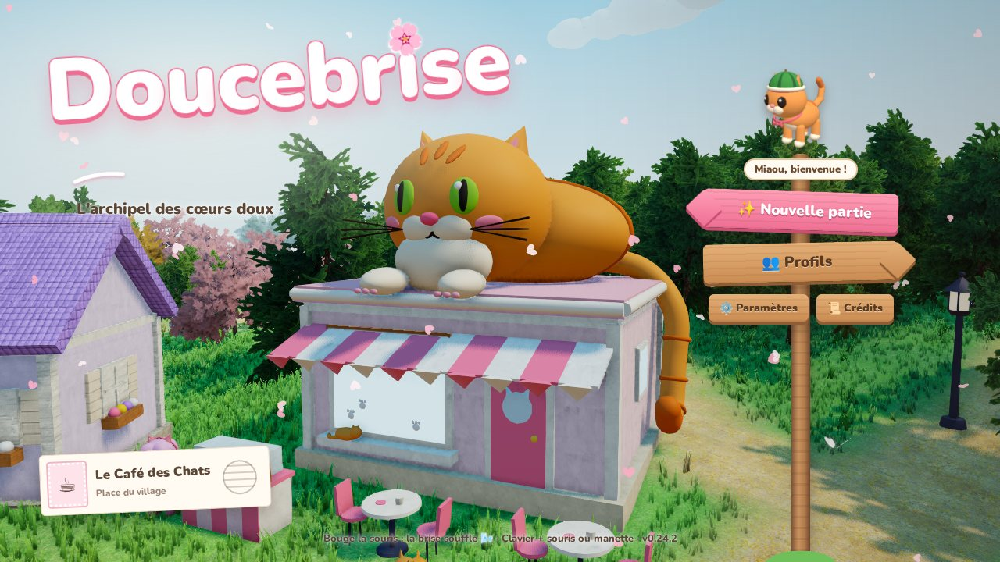
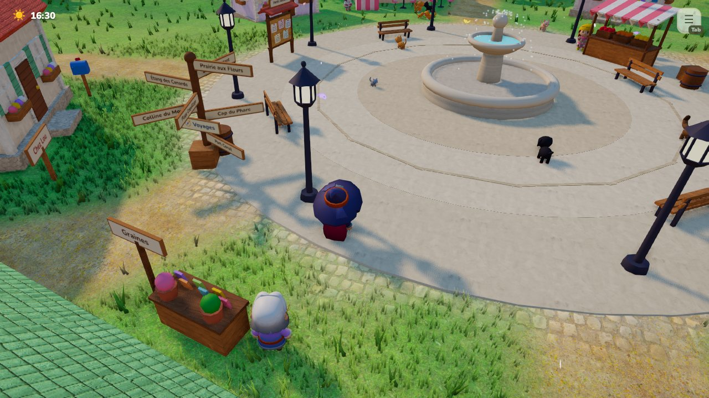
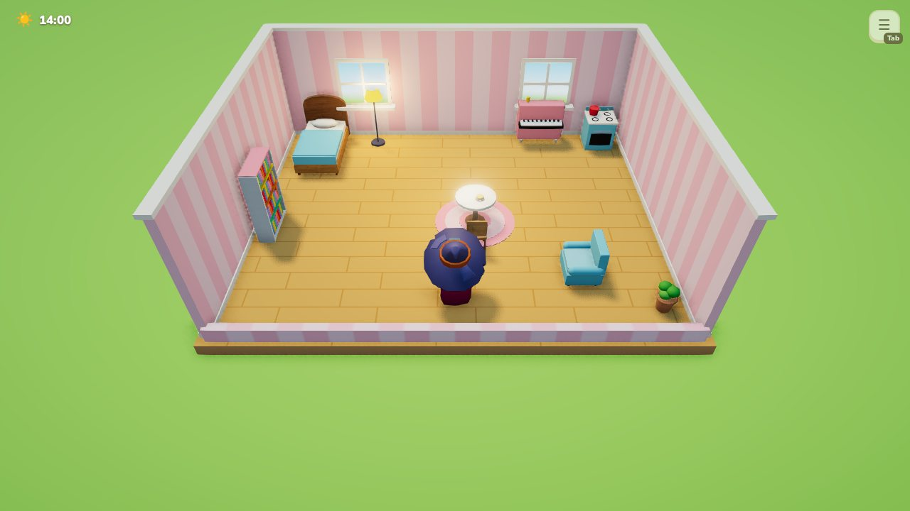
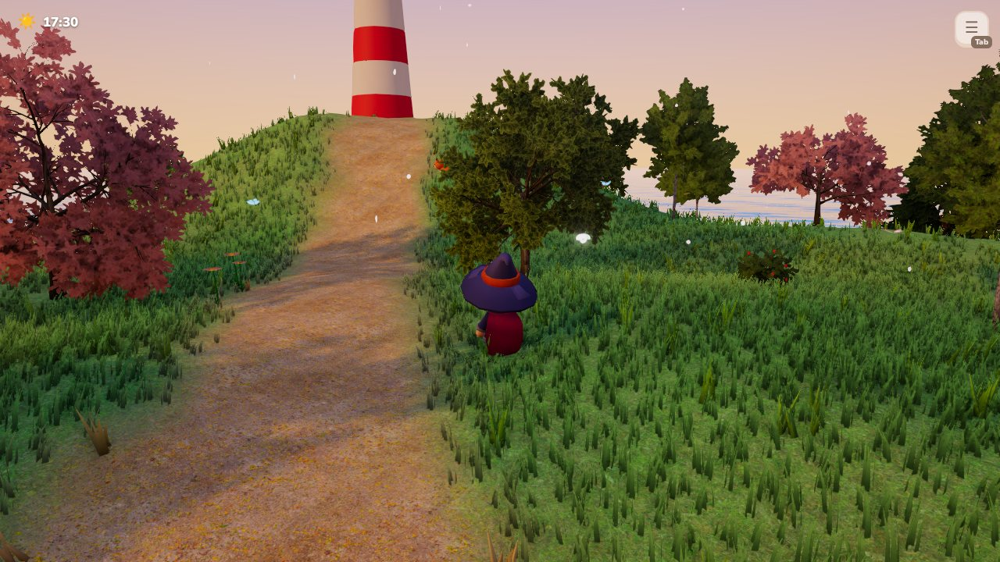
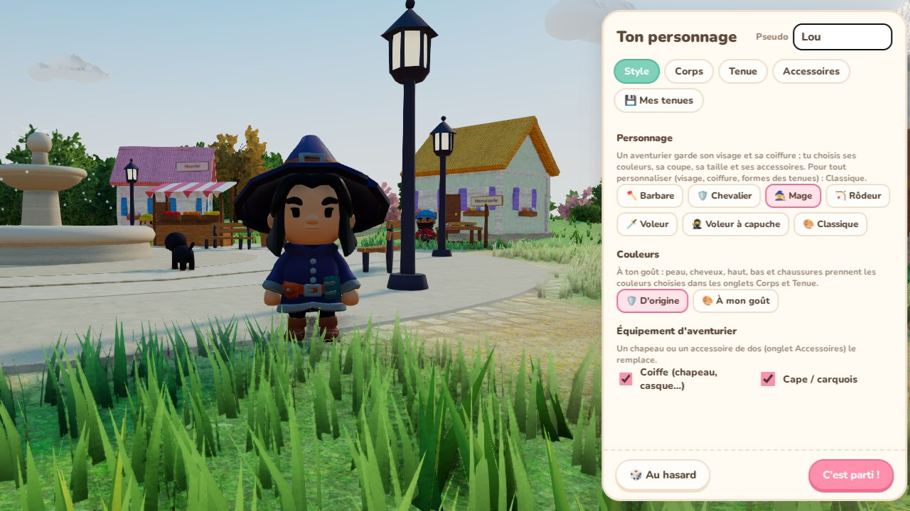

<div align="center">

# 🌸 Doucebrise

**Un jeu 3D cosy dans le navigateur : un archipel à explorer, des animaux à apprivoiser, une maison à décorer et une histoire à vivre.**

[**▶ Jouer en ligne**](https://sdelmart.github.io/Doucebrise/) · [**Télécharger** (Windows, macOS, Linux)](https://github.com/sdelmart/Doucebrise/releases/latest) · [Guide complet](docs/GUIDE.md)



</div>

## Le jeu

On arrive à Doucebrise avec une lettre de Mamie Rose : le phare de l'île s'est éteint, et le village s'est un peu perdu de vue. Au fil de **11 chapitres**, on rallume le phare, on rencontre les habitants, on relie les trois îles de l'archipel… et on découvre l'histoire de l'ancien gardien.

<table>
<tr>
<td width="50%"></td>
<td width="50%"></td>
</tr>
<tr>
<td></td>
<td></td>
</tr>
</table>

## Ce qu'on y fait

- 🏝️ **Explorer** un archipel de trois îles et trois villages, à pied, à vélo, en scooter, en bateau ou en montgolfière
- 🐾 **Apprivoiser et adopter** 16 espèces d'animaux (chats, chiens, renards, pandas roux, loutres…), les habiller, les emmener partout
- 💞 **Se lier d'amitié** avec 16 habitants qui ont chacun leur métier, leur emploi du temps, leurs goûts et leurs quêtes
- 🏡 **Construire et décorer** sa maison : plus de 150 meubles, objets à poser sur les meubles, papiers peints, façade et jardin
- 🌱 **Cultiver, pêcher, cuisiner**, attraper des insectes, faire de petits boulots
- 🌦️ **Vivre au rythme du monde** : cycle jour et nuit, quatre saisons, météo, fêtes de saison et mini-jeux (luge, feu d'artifice…)
- 📖 **Suivre l'histoire** : 49 quêtes d'histoire, 58 quêtes d'habitants, des scènes mises en scène et un carnet à retrouver page par page

Ça se joue au **clavier**, à la **manette** et au **doigt** (téléphone et tablette).

## Côté technique

| | |
|---|---|
| **Rendu 3D** | [Three.js](https://threejs.org/) : ombres, occlusion ambiante, eau à reflets, herbe dense, arbres générés au lancement, rendu réaliste ou cartoon au choix |
| **Code** | JavaScript (modules ES), environ 41 000 lignes, sans moteur de jeu ni framework d'interface |
| **Construction** | [Vite](https://vitejs.dev/) |
| **Applications** | [Electron](https://www.electronjs.org/) + electron-builder : Windows (installateur, portable), macOS (universel), Linux (`.deb`, AppImage) |
| **Monde** | Terrain, villages, maisons, animaux et meubles générés par le code ; recherche de chemin A* pour les animaux ; découpage du monde pour l'affichage (culling) |
| **Son** | Bruitages et ambiances synthétisés en direct (Web Audio) |
| **Performance** | Qualité qui s'adapte automatiquement à la machine, du petit portable au PC de jeu ; optimisé pour mobile |
| **Tests** | Tests automatisés dans Chromium sans écran : le jeu complet est joué de bout en bout (toutes les quêtes, sauvegarde et reprise) à chaque envoi, via GitHub Actions |
| **Publication** | GitHub Actions construit les applications des trois systèmes et la démo en ligne (GitHub Pages) |

## Lancer le projet

```bash
npm install
npm run dev          # version navigateur sur http://localhost:5173
npm run app          # application de bureau
npm run test:smoke   # test de fumée (après npm run build)
npm run test:quests  # joue toute l'histoire et toutes les quêtes (après npm run build)
```

Commandes, contenu détaillé, organisation du code et crédits : voir le [**guide complet**](docs/GUIDE.md).

## Crédits

- Personnages et végétation : [KayKit](https://kaylousberg.itch.io/) et [Kenney](https://kenney.nl/) (CC0)
- Textures : [Poly Haven](https://polyhaven.com/) (CC0), rameaux du projet [EZ-Tree](https://github.com/dgreenheck/ez-tree) (MIT)
- Police : [Nunito](https://fonts.google.com/specimen/Nunito) (OFL)
